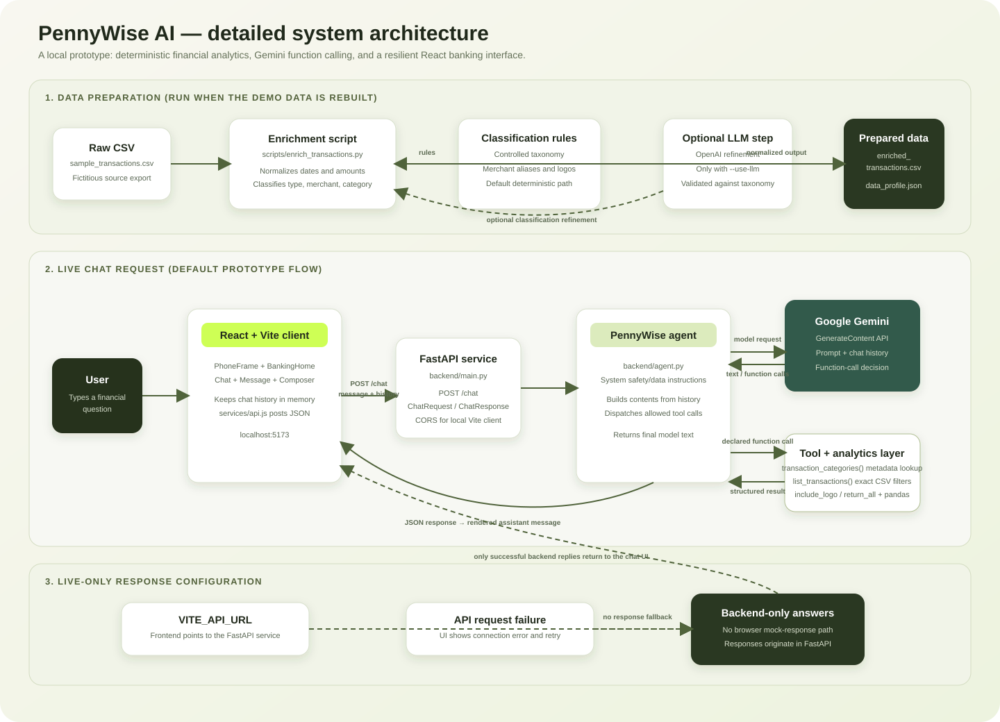

# PennyWise AI

PennyWise AI is a prototype mobile banking experience with a conversational financial coach. The React interface presents sample account activity, savings progress, and recent transactions inside a mock smartphone frame. From the **Ask PennyWise** panel, a user can ask natural-language questions about the included transaction dataset, such as spending by category, recurring charges, or unusual transactions.

## What PennyWise AI can do

PennyWise AI turns a transaction history into an approachable, on-demand financial conversation. Instead of searching through rows of purchases or working out totals by hand, a customer can ask a plain-English question and get a clear answer grounded in the account’s available data. It is designed to make everyday money decisions feel less like analysis and more like a helpful check-in with a financially savvy guide.

### Make spending instantly understandable

PennyWise can break down where money is going, so a customer can move from “I feel like I’m spending too much” to a specific, useful answer. It can total spending in a category, rank the categories that have had the greatest impact, and surface the merchants that account for the most expense.

- “How much did I spend on groceries this month?”
- “What are my top five spending categories?”
- “Which merchants have cost me the most?”
- “How much did I spend on dining in June?”

Every numeric answer is calculated from the transaction dataset at request time. That means PennyWise does not rely on generic budgeting advice or made-up figures when it explains a customer’s spending.

### Find the transactions behind the number

A total is useful; the details behind it are often what makes it actionable. PennyWise can retrieve the purchases that match a category, subcategory, merchant, or month, helping a customer review the activity behind a spending pattern. It can return a concise result set for a quick answer or the full matching history when the customer asks for every transaction. When requested, the experience can also include merchant logos to make a transaction list easier to scan.

- “Show me my coffee purchases.”
- “List all transactions from this merchant.”
- “What did I buy in the Shopping category last month?”
- “Show every recurring charge in my history.”

The assistant first checks the dataset’s actual category and subcategory vocabulary before applying a natural-language filter. This keeps results tied to the account’s real data rather than loosely guessing what a label means.

### Put monthly habits in context

PennyWise helps customers see direction, not just a single snapshot. It can summarize total spending by month, compare two months side by side, and calculate average weekly spending overall or within a category. These views make it easier to spot whether a change is a one-off moment or a habit worth paying attention to.

- “How has my spending changed month to month?”
- “Did I spend more in May or June?”
- “Compare my spending in 2026-05 and 2026-06.”
- “What is my average weekly grocery spend?”

That context supports better conversations about pacing, planning, and priorities without forcing the customer to learn a reporting tool first.

### Expose recurring costs and subscription creep

Small, repeated charges can quietly become a meaningful part of a budget. PennyWise identifies recurring expense activity, groups it by merchant, and totals the associated spend. This gives customers a straightforward view of the commitments that return month after month—ideal for reviewing subscriptions, memberships, household bills, and other regular outflows.

- “What subscriptions am I paying for?”
- “Which recurring charges cost me the most?”
- “How much am I spending on recurring expenses?”

### Help customers investigate surprises

PennyWise can flag transactions that deserve a second look. It detects exact duplicate expense entries and identifies unusually large expenses using a configurable statistical threshold. This gives a customer a practical starting point for checking potential double charges, unexpected purchases, or out-of-pattern spending before it becomes a larger problem.

- “Do I have any duplicate transactions?”
- “What purchases look unusual?”
- “Show me expenses that are much larger than normal.”

These are analytical signals, not fraud determinations. PennyWise presents the relevant account activity so the customer can decide whether to investigate further.

### Relate spending to income

For category-level affordability questions, PennyWise can calculate what portion of recorded income has gone to one or more selected spending categories, optionally for a specific month. It offers a simple way to turn a raw dollar total into a more meaningful ratio.

- “What percentage of my income goes to housing and utilities?”
- “How much of June’s income did I spend on dining and groceries?”

### Keep answers trustworthy and transparent

PennyWise is built to answer from the available transaction data, not to bluff. If a requested month falls outside the dataset’s coverage, it says the data is unavailable and identifies the available date range rather than treating missing activity as zero. The browser also does not fabricate a financial response if the backend cannot be reached; it shows a connection state and gives the customer a way to retry.

In short, PennyWise AI combines the familiarity of a banking app with the clarity of a personal finance conversation: customers can ask what matters, understand the activity behind the answer, and take the next step with more confidence.




## Architecture

The diagram below covers both flows in the prototype:

1. **Data preparation:** `scripts/enrich_transactions.py` turns the supplied raw CSV into a normalized transaction dataset, using a controlled taxonomy by default and optionally an LLM refinement path.
2. **Live chat:** the React app retains local history, sends the current message to FastAPI, and receives an answer from the PennyWise agent. For a natural-language transaction filter, Gemini first calls `transaction_categories()` to discover the current dataset metadata, then calls `list_transactions()` with an exact category/subcategory filter. The generic tool includes `logo_url` only when `include_logo=true`, so the UI can render merchant logos without category-specific code.
3. **Live-only responses:** the browser never manufactures a financial answer. If the API is unavailable, the UI displays a connection error and retry control; all assistant responses originate in the backend.

```mermaid
flowchart TB
    subgraph Preparation[Offline data preparation]
        RAW[(sample_transactions.csv)] --> ENRICH[scripts/enrich_transactions.py]
        TAX[Controlled taxonomy and merchant rules] --> ENRICH
        OPENAI[Optional OpenAI classification refinement] -. only with --use-llm .-> ENRICH
        ENRICH --> DATA[(enriched_transactions.csv)]
        ENRICH --> PROFILE[data_profile.json]
    end

    subgraph Client[Browser: React + Vite]
        USER[User] --> HOME[BankingHome and PhoneFrame]
        HOME --> CHAT[Chat, Message, SuggestedQuestions]
        CHAT --> CLIENT[services/api.js\nmessage + in-memory history]
    end

    CLIENT -->|POST /chat| API[FastAPI main.py\nChatRequest / ChatResponse]
    API --> AGENT[agent.py\nPennyWise system prompt + function-call loop]
    AGENT <-->|GenerateContent: prompt, history, tool calls| GEMINI[Google Gemini]
    AGENT --> META[transaction_categories()\nCurrent category/subcategory metadata]
    AGENT --> LIST[list_transactions()\nExact filters + include_logo + return_all]
    META --> ANALYTICS[analytics.py\nPandas deterministic calculations]
    LIST --> ANALYTICS
    AGENT --> TOOLS[Other safe analytics tool dispatch]
    TOOLS --> ANALYTICS
    ANALYTICS --> DATA
    TOOLS -->|Structured tool result| AGENT
    AGENT -->|Natural-language answer| API
    API -->|JSON response| CLIENT
    CLIENT --> CHAT
```

The editable Mermaid diagram above and the portable [SVG diagram](docs/architecture.svg) describe the same system.

## Repository structure

```text
PennyWise-AI/
├── backend/
│   ├── agent.py                 # Gemini client, prompt, and function-call loop
│   ├── analytics.py             # Pandas-based transaction analytics
│   ├── main.py                  # FastAPI app, CORS, /health, and /chat
│   ├── models.py                # Chat request and response models
│   ├── requirements.txt         # Python runtime dependencies
│   └── tools.py                 # Analytics functions exposed to the agent
├── data/
│   ├── data_profile.json              # Generated dataset coverage/profile metadata
│   ├── enriched_transactions.csv      # Normalized demo data used by analytics
│   └── sample_transactions.csv        # Source demo transaction export
├── docs/
│   └── architecture.svg         # Detailed standalone system diagram
├── frontend/
│   ├── src/
│   │   ├── components/
│   │   │   ├── BankingHome.jsx
│   │   │   ├── Chat.jsx
│   │   │   ├── Header.jsx
│   │   │   ├── Message.jsx
│   │   │   ├── NamePrompt.jsx
│   │   │   ├── PhoneFrame.jsx
│   │   │   ├── SuggestedQuestions.jsx
│   │   │   ├── TransactionItem.jsx
│   │   │   └── TypingIndicator.jsx
│   │   ├── services/api.js             # Live FastAPI client
│   │   ├── styles/index.css            # Mobile banking visual system
│   │   ├── App.jsx                     # Top-level application state and routing
│   │   └── main.jsx                    # React entry point
│   ├── index.html
│   ├── package-lock.json
│   └── package.json
├── scripts/
│   └── enrich_transactions.py    # Data normalization/enrichment command
├── .env.example                  # GEMINI_API_KEY template
├── .gitignore
└── README.md
```

## Prerequisites

- Node.js 20 or later and npm
- Python 3.11 or later
- A Google Gemini API key to use the live AI path.
- Optional: an OpenAI API key only when running the data-enrichment script with `--use-llm`.

## Packages to install

### Frontend

Run `npm install` in `frontend/`. It installs:

- `react` and `react-dom`
- `vite` and `@vitejs/plugin-react`
- `react-markdown`

### Backend

Create and activate a virtual environment, then install the small runtime dependency set:

```bash
python3 -m venv .venv
source .venv/bin/activate
pip install -r requirements.txt
```

The repository’s `backend/requirements.txt` lists the same portable runtime packages, so you can alternatively run `pip install -r backend/requirements.txt`.

The data-enrichment script has an optional OpenAI-assisted classification mode. Install `openai` and set `OPENAI_API_KEY` only if you plan to run `python scripts/enrich_transactions.py --use-llm`.

## Run locally

1. Clone the repository and move into it.

   ```bash
   git clone https://github.com/EmmaYHlee/PennyWise-AI.git
   cd PennyWise-AI
   ```

2. Configure the live AI integration (optional). Copy the example environment file and add a valid key.

   ```bash
   cp .env.example .env
   ```

   ```dotenv
   GEMINI_API_KEY=your_gemini_api_key
   # Required only for scripts/enrich_transactions.py --use-llm
   OPENAI_API_KEY=your_openai_api_key
   ```

3. In one terminal, activate the Python environment and start the API from the repository root.

   ```bash
   source .venv/bin/activate
   uvicorn backend.main:app --reload --port 8000
   ```

   Confirm it is running at [http://localhost:8000/health](http://localhost:8000/health).

4. In a second terminal, install frontend dependencies and start Vite.

   ```bash
   cd frontend
   npm install
   npm run dev
   ```

5. Open the local address printed by Vite, normally [http://localhost:5173](http://localhost:5173). Enter a name, tap **Ask PennyWise**, and submit a financial question.

## Useful commands

```bash
# Build the frontend for production
cd frontend && npm run build

# Run the backend API
uvicorn backend.main:app --reload --port 8000

# Rebuild the enriched demo transaction data
python scripts/enrich_transactions.py
```

## Notes

- The browser client defaults to `http://localhost:8000`; set `VITE_API_URL` if your API uses a different address.
- The current app is a prototype, not a production banking service. It has no authentication, persistent user accounts, or real financial connections.
- Keep API keys out of version control. `.env` is intentionally ignored.
